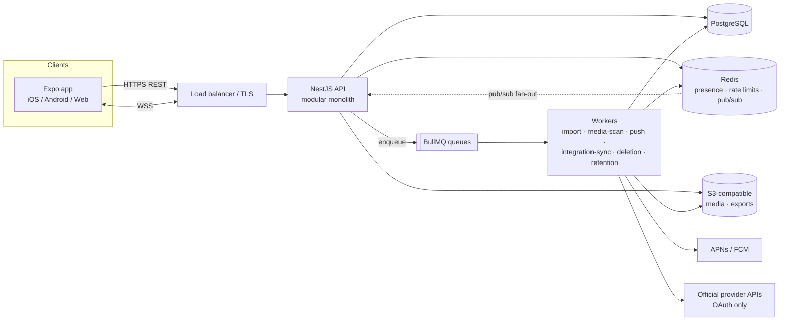
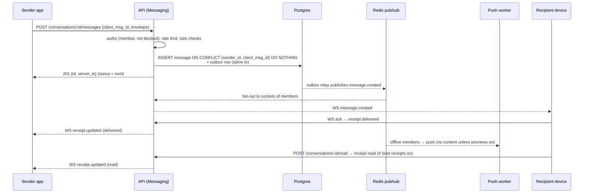
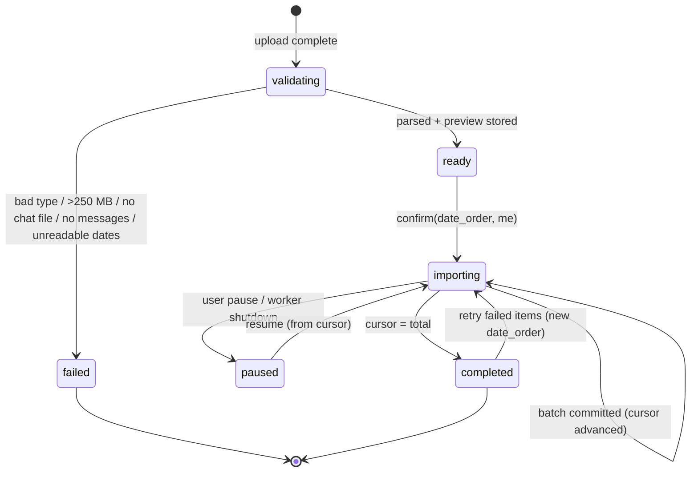

# hye: Architecture

This document describes the target server architecture and how the on-device prototype maps onto it. For product scope and the integration rules, see [PRODUCT.md](./PRODUCT.md).

> **Status.** The Expo app in [`src/`](../src) runs with no server. The server lives in [`backend/`](../backend), a NestJS modular monolith that is being built in parallel. Where this document and [`backend/db/migrations/001_init.sql`](../backend/db/migrations/001_init.sql) disagree on table or column names, **the migration is authoritative**. Read this document as the design intent.

---

## 1. System overview

**Shape:** one deployable NestJS application, the modular monolith, plus separate worker processes that run the same codebase with a different entry point.

| Component | Technology | Role |
|---|---|---|
| API | NestJS (HTTP + WebSocket gateway) | REST for commands and queries; WebSocket for realtime fan-out |
| Primary store | PostgreSQL | Source of truth for all relational data, including the import ledger |
| Cache / realtime | Redis | Presence and typing (TTL keys), rate-limit counters, pub/sub between API instances, BullMQ backing store |
| Object storage | S3-compatible | Media, uploaded exports, data-export bundles |
| Jobs | BullMQ workers | Import parsing and batches, media scanning and thumbnails, push, integration sync, account deletion, retention sweeps |
| Push | APNs / FCM | Notifications. Payloads carry no message content unless the user enables previews. |

---

## 2. Design rules

1. **Modules own their tables.** A module reads and writes only its own tables. Other modules reach that data through the owning module's exported service or through domain events. Cross-module SQL joins are allowed only in read models owned by Search or Analytics.
2. **Commands go over REST, realtime goes over WebSocket.** The socket pushes events. Clients send mutations over REST, with one exception: typing indicators, which are ephemeral.
3. **Every mutating endpoint is idempotent.** Clients send an `Idempotency-Key` header (or, for messages, a `client_msg_id`). Imports are idempotent by construction (§5.2).
4. **Long or retryable work runs in a queue.** Request handlers never run parsing, scanning or third-party calls inline.
5. **Domain events are written to an outbox table** in the same transaction as the state change. A relay then publishes them to Redis and BullMQ. This avoids dual writes.

---

## 3. Modules and domain boundaries

| Module | Owns (data) | Responsibilities | Emits / consumes |
|---|---|---|---|
| **Identity & Auth** | users (auth part), passkey credentials, sessions, recovery codes | WebAuthn registration and assertion, session issue / refresh / revoke, device list | emits `account.created`, `session.revoked` |
| **Profiles** | display name, handle, avatar | Handle uniqueness, profile reads, avatar via Media | emits `profile.updated` |
| **Contacts** | contacts, blocks | Handle lookup, contact list, block / unblock (enforced at send time) | emits `contact.blocked` |
| **Conversations** | conversations, conversation members (per-user state: pinned, muted, archived, marked_unread, last_read_at, retention) | Create a 1:1 conversation (deduplicated per pair), inbox listing, per-user flags, read cursors | emits `conversation.created`, `conversation.read` |
| **Messaging** | messages, reactions, delivery receipts | Send / edit / delete-for-everyone, reply, forward, reactions, receipts, ordering | emits `message.created/edited/deleted`, `receipt.updated` |
| **Groups** | group roles, membership changes | Admin rules, add / remove / promote, rename, leave, system messages | emits `group.member_added/removed`, `group.renamed` |
| **Integrations** | connected accounts, OAuth tokens (encrypted), sync cursors, capability catalog | OAuth connect / disconnect, scheduled sync through **official APIs only**, the capability matrix (server copy of [`catalog.ts`](../src/integrations/catalog.ts)) | emits `integration.synced/failed` |
| **Import & Migration** | import jobs, the import item ledger, stored exports | Validate, parse, plan, preview, batched import, resume / retry, migration report | emits `import.*`; writes messages through the Messaging service |
| **Media** | attachments metadata, object keys | Pre-signed uploads, type and size validation, malware scan, thumbnails, signed download URLs | emits `media.scanned`, `media.rejected` |
| **Search** | search index (Postgres FTS / `tsvector` at first) | Index native and imported messages and file names; per-user ACL filter at query time | consumes `message.*`, `conversation.*` |
| **Notifications** | device push tokens, notification prefs | Fan-out to APNs and FCM, honouring mute, prefs and preview settings | consumes `message.created`, `import.completed` |
| **Privacy & Consent** | privacy settings, consents, retention policies, data-export and deletion requests | Read receipts, typing and last-seen gates; retention sweeps; export bundle; account deletion orchestration | consumes / emits `account.deletion_*` |
| **Moderation** | reports, actions | Accept reports (with user-consented message excerpts), review queue, enforcement | emits `moderation.action` |
| **Analytics** | event stream (no content) | Product metrics (PRODUCT §7), opt-out honoured | consumes the outbox |
| *(cross-cutting)* **Audit** | audit events | Append-only log of security-sensitive actions, visible to the user | consumes from all modules |

---

## 4. API outline

All REST paths are under `/v1`. Requests authenticate with a session bearer token. Lists use opaque `cursor` / `limit` pagination.

### REST

| Area | Endpoints |
|---|---|
| Auth | `POST /auth/passkey/register/options` · `POST /auth/passkey/register` · `POST /auth/passkey/login/options` · `POST /auth/passkey/login` · `POST /auth/refresh` · `GET /auth/sessions` · `DELETE /auth/sessions/:id` · `POST /auth/logout` |
| Profile | `GET /me` · `PATCH /me` · `GET /users/by-handle/:handle` |
| Contacts | `GET /contacts` · `POST /contacts` · `POST /contacts/:id/block` · `DELETE /contacts/:id/block` |
| Conversations | `GET /conversations?tab=&platform=&person=&since=&media=&cursor=` · `POST /conversations` (direct or group) · `GET /conversations/:id` · `PATCH /conversations/:id` (pinned, muted, archived, marked_unread, retention, title) · `POST /conversations/:id/read` · `DELETE /conversations/:id` (removes it for the caller) |
| Groups | `POST /conversations/:id/members` · `PATCH /conversations/:id/members/:userId` (role) · `DELETE /conversations/:id/members/:userId` · `POST /conversations/:id/leave` |
| Messages | `GET /conversations/:id/messages?before=&q=` · `POST /conversations/:id/messages` (`client_msg_id`, ciphertext or plaintext envelope, `reply_to_id`, `forwarded_from`, `attachment_ids`) · `PATCH /messages/:id` · `DELETE /messages/:id` · `PUT /messages/:id/reactions/:emoji` · `DELETE /messages/:id/reactions/:emoji` |
| Media | `POST /media/uploads` (returns a pre-signed PUT URL) · `POST /media/:id/complete` · `GET /media/:id` (returns a signed GET URL once the file is scanned clean) |
| Import | `POST /imports` (create a job, get an upload URL) · `POST /imports/:id/analyse` · `GET /imports/:id/preview` · `POST /imports/:id/confirm` (`date_order`, `me`) · `POST /imports/:id/pause` · `POST /imports/:id/resume` · `POST /imports/:id/retry` (`date_order`, failed items only) · `GET /imports/:id` · `GET /imports/:id/report` (`hye-migration-report/1`) · `DELETE /imports/history` |
| Search | `GET /search?q=&scope=all\|native\|imported&cursor=` |
| Integrations | `GET /integrations` (capability matrix) · `POST /integrations/:platform/connect` (starts OAuth) · `GET /integrations/:platform/callback` · `DELETE /integrations/:platform` |
| Privacy & data | `GET/PATCH /me/privacy` · `GET/PATCH /me/notifications` · `POST /me/push-tokens` · `POST /me/export` (async; produces `hye-export/1`) · `POST /me/deletion` · `DELETE /me/deletion` (cancel within the grace period) · `GET /me/audit` |
| Moderation | `POST /reports` |
| Saved links | `GET /saved-links` · `POST /saved-links` · `DELETE /saved-links/:id` |

### WebSocket (`/v1/ws`)

The client authenticates on connect and is subscribed to `user:{id}`. Every server event carries a monotonic per-user `seq`. After a reconnect the client sends `resume {last_seq}` and receives the events it missed. If the gap is too large, the server returns `resync_required`.

| Direction | Event | Payload (abridged) |
|---|---|---|
| S→C | `message.created` / `message.edited` / `message.deleted` | message envelope, conversation id |
| S→C | `receipt.updated` | message id, user id, `delivered` or `read`, timestamp (only if the sender's and reader's settings allow) |
| S→C | `reaction.updated` | message id, reactions |
| S→C | `conversation.updated` | changes to flags, title or members |
| S→C | `typing` | conversation id, user id (sent only if both users have typing indicators on) |
| S→C | `presence` | user id, online / last seen (filtered by `last_seen` visibility) |
| S→C | `import.progress` / `import.completed` / `import.failed` | job id, cursor, total, counters |
| C→S | `typing.start` / `typing.stop` | conversation id (rate-limited) |
| C→S | `ack` | message ids delivered to this device |

---

## 5. Event flows

### 5.1 Send a native message

The client status machine is `sending → sent → delivered → read`, or `failed`. This matches `DeliveryStatus` in [`types.ts`](../src/domain/types.ts). A client retry with the same `client_msg_id` returns the original row and never creates a duplicate.

### 5.2 Import job lifecycle

The server pipeline reuses the pure domain functions already in the app: `parseWhatsAppExport`, `planImport`, `previewImport` and `runImportBatch` in [`whatsapp.ts`](../src/domain/import/whatsapp.ts) and [`pipeline.ts`](../src/domain/import/pipeline.ts). The statuses match `ImportStatus` in [`types.ts`](../src/domain/types.ts).

1. **Upload.** The client gets a pre-signed URL, then uploads the `.txt` or `.zip`. Media checks the size limit (250 MB, as `MAX_EXPORT_BYTES` in [`importer.ts`](../src/services/importer.ts)) and the extension, then runs a malware scan.
2. **Validate and analyse (worker).** Unzip, locate `_chat.txt`, and drop blocked extensions and dotfiles (`BLOCKED_EXTENSIONS`). Parse the file and detect the possible date orders. Derive `conversation_key = H("whatsapp|" + title + "|" + sorted participants)`, so the same chat exported again maps to the same conversation.
3. **Plan.** Every record gets a deterministic `source_key = H("wa|" + conversation_key + "|" + sent_at + "|" + sender + "|" + H(text) + "|" + attachment names + "|" + occurrence#)`. The occurrence counter keeps genuine repeats, such as two identical "ok" messages in the same minute, while still deduplicating re-imports. The server uses SHA-256 for H. The device uses cyrb53 ([`hash.ts`](../src/domain/hash.ts)).
4. **Preview.** Store and return the counts: duplicates already present, invalid dates, missing and omitted media, and the "not preserved" list. Nothing is written to `messages` yet.
5. **Confirm, then batched import.** For each batch (about 200–250 items), the worker runs **one transaction**:
   - `INSERT … ON CONFLICT (user_id, source_key) DO NOTHING` into the import item ledger and messages.
   - Insert per-item outcomes (`imported | skipped | failed` + reason + `source_ref` line range).
   - `UPDATE import_jobs SET cursor = :end, counters…`.
   - Insert an outbox `import.progress` row.
6. **Idempotency.** The unique constraint on **`(user_id, source_key)`** is the guarantee:
   - A crash mid-batch rolls the whole batch back.
   - A crash after commit resumes at the saved cursor.
   - A re-upload of an overlapping export skips keys that already exist.
   - Replaying a batch is harmless.
7. **Resume.** Read the job's `cursor`, re-plan from the stored export (planning is deterministic), and continue. **Retry** re-plans with another `date_order` and processes only the items marked `failed`.
8. **Complete.** Set `completed_at`, update the conversation's `last_activity_at`, emit `import.completed` (push if enabled), and write the audit event `import.completed`. The report follows `hye-migration-report/1` (`migrationReport` in [`pipeline.ts`](../src/domain/import/pipeline.ts)).

Imported conversations are `origin = 'imported'`. They are read-only, muted by default, never count as unread, and are never deleted by retention timers (`expiredMessageIds` in [`selectors.ts`](../src/state/selectors.ts)).

### 5.3 Account deletion

1. `POST /me/deletion` requires a fresh passkey assertion. It writes the audit event `account.deletion_requested`, revokes all other sessions, and starts a grace period (proposed: 7 days) that can be cancelled with `DELETE /me/deletion`.
2. When the grace period ends, the deletion worker:
   1. Revokes all integration tokens with their providers.
   2. Deletes push tokens.
   3. Deletes the user's import jobs, the ledger, stored exports and imported conversations.
   4. Deletes media objects the user owns, in S3 batches.
   5. For native conversations, deletes the user's membership and tombstones their sent messages (the content is removed and a "deleted account" sender placeholder stays, so other members' threads remain coherent).
   6. Deletes contacts, saved links, settings and passkeys.
   7. Removes the user's documents from the search index.
   8. Pseudonymises Analytics rows.
3. Each step is idempotent and checkpointed, so the job can be re-run safely. The final record is a minimal deletion receipt (user ID hash and timestamp) kept for legal compliance. Backups age out within the backup retention window.

---

## 6. Access control

- **Subject:** an authenticated session bound to a user and a device.
- **Conversation access:** a user can read or write a conversation only while they are in its member table. Every message, reaction, receipt and media query is scoped by membership. Postgres row-level security on `user_id` / membership is the defence-in-depth layer under the service-level checks.
- **Roles:** `admin | member` per group (`Member.role` in [`types.ts`](../src/domain/types.ts)). Only admins can rename, add, remove or promote, and a group must always keep at least one admin. Only the sender can edit or delete-for-everyone a message.
- **Imported conversations** have exactly one member, the importer. Imported participants are display strings with no account behind them (`importedParticipants`), so they get no access.
- **Blocks:** a block is enforced at send time (`403`). Blocked users' direct chats are hidden from the inbox, which matches `inboxRows`.
- **Media:** a signed URL is issued only to members of the conversation that references the object, and only after the scan passes.
- **Privacy gates:** the receipt, typing and presence emitters check both parties' settings on the server, not only in the client.

---

## 7. Security

| Control | Design |
|---|---|
| **Authentication** | Passkeys (WebAuthn) as the primary method; no passwords. Recovery uses one-time recovery codes or a second passkey. Fresh re-authentication is required for deletion, export and adding a passkey. |
| **Sessions** | Short-lived access token (about 15 min) plus a rotating refresh token tied to the device. Refresh-token reuse revokes the whole chain. Users can list and revoke sessions (the Devices page). |
| **Transport** | TLS 1.2+ everywhere and HSTS on web. Certificate pinning is optional on mobile. |
| **At rest** | Postgres and S3 encryption at rest using KMS-managed keys. Integration OAuth tokens are additionally envelope-encrypted per row. |
| **E2EE (native 1:1 and groups)** | Use a vetted protocol, not a custom one: **MLS (RFC 9420)** for groups and a Signal-style double ratchet (or MLS for both) for 1:1. Private keys are generated and kept on the client; the server stores only public key packages and ciphertext. The consequences: server-side search and content moderation for E2EE chats are not possible, so search runs on the device over decrypted local data, and reports carry excerpts the reporter chooses to share. Rollout is phased; until it ships, the UI must not claim E2EE. |
| **Imported history is NOT E2EE** | Imported third-party history is a copy the user uploaded. It is protected by TLS and encryption at rest, **not** by end-to-end encryption. It is server-searchable, and the UI says so. The prototype already states this ([`import.tsx`](../src/app/import.tsx), [`settings/[page].tsx`](../src/app/settings/[page].tsx)). |
| **Uploads** | Pre-signed, size-capped uploads with an allow-list of content types and a blocked list of executable extensions (as on device in [`importer.ts`](../src/services/importer.ts) and [`ConversationView.tsx`](../src/components/ConversationView.tsx)). Uploads stay in a quarantine bucket until a **malware scan** (ClamAV or a managed scanner) passes. Image EXIF metadata is stripped. Zip imports are guarded against zip bombs and path traversal. |
| **Rate limiting** | Redis token buckets per user, per IP and per route class (auth, send, upload, search, typing). Responses return `429` with `Retry-After`. |
| **Abuse** | Contact-request and new-conversation limits for new accounts. The block list is enforced on the server. |
| **Audit logs** | An append-only `audit_events` table for security-sensitive actions (sign-in, session revoke, privacy change, import start / complete / retry, export, deletion, block, report). It is shown to the user (Security activity) and retained according to policy. The prototype's action names (`account.created`, `import.completed`, `privacy.changed`, …) are the starting vocabulary. |
| **Secrets** | Secrets come from a secret manager and never from the repo. Integration client secrets are rotated. |

---

## 8. Observability

- **Logs:** structured JSON (pino), one line per request and per job step. Fields: `trace_id`, `user_id` (hashed), `route`, `status`, `duration_ms`, `job_id`. **No message content, file names or export lines in logs.**
- **Traces:** OpenTelemetry SDK in the API and workers. Context propagates through HTTP, BullMQ job data and the WebSocket fan-out. Traces are exported over OTLP.
- **Metrics:** Prometheus / OTel metrics, for example:
  - `http_request_duration_seconds`
  - `ws_connections`
  - `message_send_to_deliver_seconds`
  - `queue_depth{queue}`, `job_duration_seconds{queue}`, `job_failures_total{queue,reason}`
  - `import_items_total{outcome}`
  - `media_scan_rejections_total`
  - `integration_sync_lag_seconds{platform}`
- **SLOs (initial):**

| SLO | Target |
|---|---|
| API availability (non-5xx) | 99.9% / 30 days |
| Send → delivered to an online recipient | p95 < 1 s; 99.9% < 5 s |
| Import throughput | ≥ 2,000 items / s per worker; 99% of jobs with ≤ 50k records complete in < 2 min after confirm |
| Search latency | p95 < 300 ms |
| Integration sync success | ≥ 99.5% of runs |

---

## 9. Error handling conventions

- **HTTP errors** use RFC 9457 `application/problem+json`: `type`, `title`, `status`, `detail`, plus `code` (a stable machine string such as `import.file_too_large`, `message.blocked`, `auth.reauth_required`) and `trace_id`.
- **Status codes:**
  - `400` validation
  - `401` unauthenticated
  - `403` forbidden or blocked
  - `404` not found or not a member (do not leak whether the resource exists)
  - `409` conflict / idempotency mismatch
  - `413` too large
  - `422` unprocessable export
  - `429` rate-limited
  - `5xx` server errors
- **User-facing copy** is written for the user and says what to do next. The prototype's `ImportError` messages are the model ([`importer.ts`](../src/services/importer.ts)), for example "This file is larger than 250 MB. Export the chat again 'Without media', or split it."
- **Per-item failures do not fail the job.** Import items fail individually with a reason and a `source_ref`; the job completes with counters. Only structural problems (unreadable archive, no messages, no valid date order) fail the job.
- **Jobs:** BullMQ retries with exponential backoff for transient errors. After the retry limit, the job goes to a dead-letter queue with an alert. Handlers must be idempotent.
- **Client:** optimistic UI with an explicit `failed` state and a retry action, never silent drops.

---

## 10. How the prototype maps onto the server

The on-device prototype is the client, with the server's responsibilities implemented locally behind the same domain types.

| Prototype | Server equivalent |
|---|---|
| [`src/domain/types.ts`](../src/domain/types.ts) (`User`, `Contact`, `Conversation`, `Member`, `Message`, `Attachment`, `Reaction`, `ImportJob`, `ImportItemResult`, `SavedLink`, `AuditEvent`, `PrivacySettings`, `NotificationPrefs`) | Tables in [`001_init.sql`](../backend/db/migrations/001_init.sql). The header comment says the types mirror the schema. camelCase maps to snake_case. Arrays such as `members`, `reactions`, `attachments` and `results` become child tables. |
| `Conversation.pinned/muted/archived/markedUnread/lastReadAt/retention` | Per-user columns on the conversation member row. On device there is only one user, so they sit on the conversation. |
| `senderId: 'me'` / `contactId: 'me'` | The real user ID |
| `Message.sourceKey` / `sourceRef`, `ImportJob.cursor` | `messages.source_key` with UNIQUE `(user_id, source_key)`, plus the job cursor column |
| [`pipeline.ts`](../src/domain/import/pipeline.ts) and [`whatsapp.ts`](../src/domain/import/whatsapp.ts) (pure, no I/O) | Run unchanged inside the import worker |
| [`importer.ts`](../src/services/importer.ts) (device file I/O, `persistExport` / `reloadExport`) | Media (S3 upload) plus the import worker (stored export) |
| [`store.tsx`](../src/state/store.tsx) reducer + AsyncStorage + `flush()` between batches | Postgres transactions per batch; an API client cache on device |
| `simulateDemo` (timers for delivery, read, typing and replies) | Real receipts and typing over WebSocket. Removed when the server ships. |
| [`selectors.ts`](../src/state/selectors.ts) `inboxRows` / `searchMessages` / `expiredMessageIds` | `GET /conversations` filters, `GET /search`, and the retention sweep job |
| [`catalog.ts`](../src/integrations/catalog.ts) | `GET /integrations` (served by the server, so updates don't need an app release) |
| `audit()` → `state.audit` (capped at 500 entries) | The `audit_events` table |
| Export JSON `hye-export/1`, report `hye-migration-report/1` | The same formats, produced by the export job and `GET /imports/:id/report` |

**Moving data from device to server** (opt-in upload of local history) will need re-keying. Device source keys are cyrb53, the server's are SHA-256. Since planning is deterministic, the server can re-plan from a stored export. For history without a stored export, the server derives keys from the message fields.

---

## 11. When to split services

Stay a monolith until there is a measured reason to split. Module boundaries (§2) keep a later extraction mechanical. Candidates, with their triggers:

| Candidate | Split when |
|---|---|
| **Realtime gateway** (WebSocket fan-out, presence) | Socket connection count or memory dominates API scaling, or deploys disrupt long-lived connections |
| **Import & media workers** | Already separate processes. Give them their own service and database role when CPU-heavy parsing or scanning competes with the API, or when they need different compliance boundaries. |
| **Search** | Postgres FTS misses the p95 < 300 ms target at current scale. Move to OpenSearch fed from the outbox. |
| **Integrations** | Provider-specific SDKs, secrets and rate limits need isolation, or a provider's terms require a separate data-processing boundary |
| **Analytics** | Event volume affects the primary database. Stream the outbox to a warehouse. |

Split by moving one module along with its tables and its outbox consumers. Never split by sharing a database across services.
